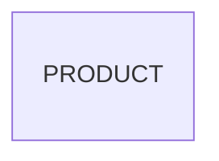

# Entity Model

## Entity Relationship Diagram

### PRODUCT

An article the shop sells.

| Attribute | Description                       | Data Type | Length/Precision | Validation Rules      |
|-----------|-----------------------------------|-----------|------------------|-----------------------|
| id        | Unique identifier                 | Long      | 19               | Primary Key, Sequence |
| name      | Product name                      | String    | 150              | Not Null              |
| category  | Product category                  | String    | 60               | Not Null              |
| price     | Unit price in CHF                 | Decimal   | 10,2             | Not Null              |
| imageUrl  | Address of the product picture    | String    | 500              | Optional              |
| inStock   | Whether the product is in stock   | Boolean   | 1                | Not Null              |
