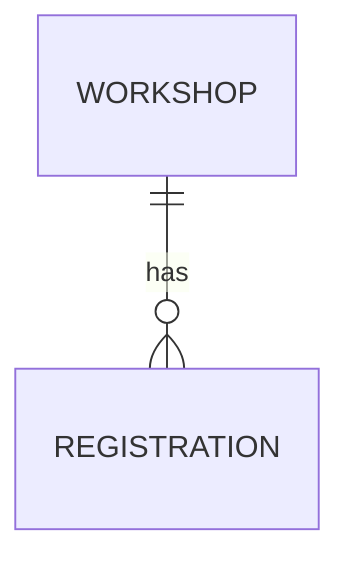

# Entity Model

### WORKSHOP

A training session participants register for.

| Attribute | Description                         | Data Type | Length/Precision | Validation Rules      |
|-----------|-------------------------------------|-----------|------------------|-----------------------|
| id        | Unique identifier                   | Long      | 19               | Primary Key, Not Null |
| title     | Title shown to participants         | String    | 200              | Not Null              |
| starts_at | Start of the workshop               | DateTime  | -                | Not Null              |
| capacity  | Maximum number of registrations     | Integer   | 10               | Not Null, Min: 1      |

### REGISTRATION

The reserved place of one participant in one workshop.

| Attribute         | Description                    | Data Type | Length/Precision | Validation Rules                    |
|-------------------|--------------------------------|-----------|------------------|-------------------------------------|
| id                | Unique identifier              | Long      | 19               | Primary Key, Not Null               |
| workshop_id       | Workshop registered for        | Long      | 19               | Not Null, Foreign Key (WORKSHOP.id) |
| participant_name  | Name of the participant        | String    | 100              | Not Null                            |
| participant_email | Email of the participant       | String    | 255              | Not Null, Format: Email             |
| registered_at     | Time the registration was made | DateTime  | -                | Not Null                            |

Cross-attribute rule: the combination of `workshop_id` and `participant_email` is unique.
