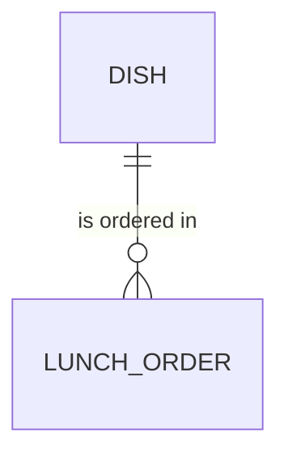

# Entity Model

### DISH

A meal the canteen cooks for one day in a limited number of portions.

| Attribute  | Description                          | Data Type | Length/Precision | Validation Rules      |
|------------|--------------------------------------|-----------|------------------|-----------------------|
| id         | Unique identifier                    | Long      | 19               | Primary Key, Not Null |
| name       | Name shown on the menu               | String    | 100              | Not Null              |
| lunch_date | Day the dish is served               | Date      | -                | Not Null              |
| price      | Price of one portion in CHF          | Decimal   | 6,2              | Not Null, Min: 0      |
| portions   | Number of portions the kitchen cooks | Integer   | 5                | Not Null, Min: 1      |

### LUNCH_ORDER

One portion of a dish that the canteen keeps for one employee.

| Attribute       | Description                               | Data Type | Length/Precision | Validation Rules                 |
|-----------------|-------------------------------------------|-----------|------------------|----------------------------------|
| id              | Unique identifier                         | Long      | 19               | Primary Key, Not Null            |
| dish_id         | Dish that is ordered                      | Long      | 19               | Not Null, Foreign Key (DISH.id)  |
| employee_number | Employee number of the employee           | String    | 6                | Not Null, Format: six digits     |
| lunch_date      | Day of the lunch, the day of the dish     | Date      | -                | Not Null                         |
| price           | Price the employee pays in CHF            | Decimal   | 6,2              | Not Null, Min: 0                 |
| ordered_at      | Time the order was placed                 | DateTime  | -                | Not Null                         |

Cross-attribute rule: the combination of `employee_number` and `lunch_date` is unique.
