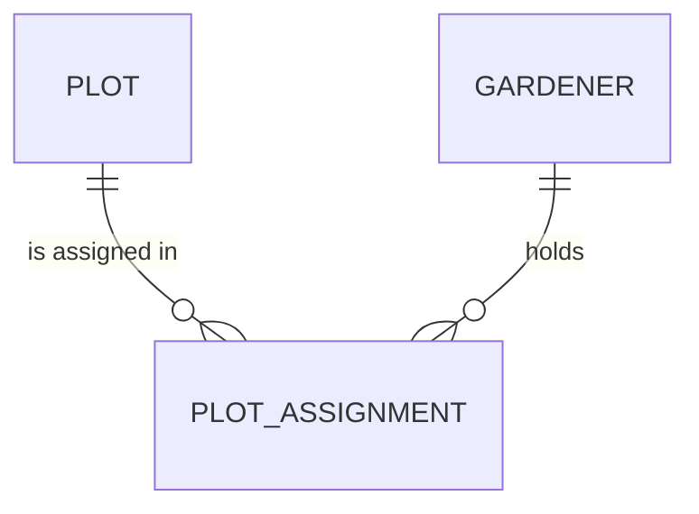

# Entity Model

### PLOT

A numbered piece of land in the garden that one gardener works for a season.

| Attribute | Description                                   | Data Type | Length/Precision | Validation Rules      |
|-----------|-----------------------------------------------|-----------|------------------|-----------------------|
| id        | Unique identifier                             | Long      | 19               | Primary Key, Not Null |
| number    | Plot number painted on the plot sign          | String    | 10               | Not Null, Unique      |
| area      | Area in square metres                         | Integer   | 5                | Not Null, Min: 1      |
| closed    | Whether the plot is closed and not offered    | Boolean   | -                | Not Null              |

### GARDENER

A member of the garden who works one or more plots.

| Attribute  | Description          | Data Type | Length/Precision | Validation Rules        |
|------------|----------------------|-----------|------------------|-------------------------|
| id         | Unique identifier    | Long      | 19               | Primary Key, Not Null   |
| first_name | First name           | String    | 100              | Not Null                |
| last_name  | Last name            | String    | 100              | Not Null                |
| email      | Email address        | String    | 255              | Not Null, Unique, Format: Email |

### PLOT_ASSIGNMENT

The allocation of one plot to one gardener for one season.

| Attribute   | Description                              | Data Type | Length/Precision | Validation Rules                    |
|-------------|------------------------------------------|-----------|------------------|-------------------------------------|
| id          | Unique identifier                        | Long      | 19               | Primary Key, Not Null               |
| plot_id     | Plot that is assigned                    | Long      | 19               | Not Null, Foreign Key (PLOT.id)     |
| gardener_id | Gardener who works the plot              | Long      | 19               | Not Null, Foreign Key (GARDENER.id) |
| season      | Calendar year the assignment is for      | Integer   | 4                | Not Null                            |
| note        | Free-text note of the coordinator        | String    | 200              | Max: 200 characters                 |
| assigned_at | Time the assignment was recorded         | DateTime  | -                | Not Null                            |

Cross-attribute rule: the combination of `plot_id` and `season` is unique.
