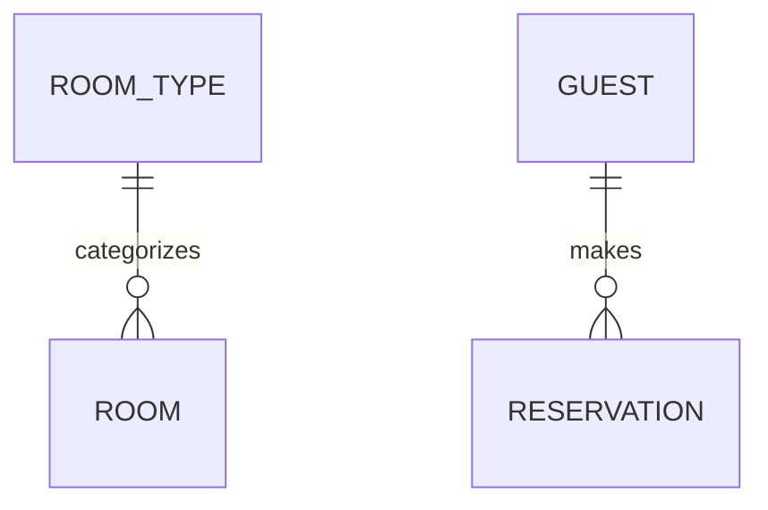

<!--
Copyright 2025-2026 Simon Martinelli and the AI Unified Process contributors.
Part of the AI Unified Process — https://unifiedprocess.ai
Licensed under the Apache License, Version 2.0. See LICENSE and NOTICE.
-->

# Entity Model

## Instructions

Create or update the entity model at `docs/entity_model.md` based on `docs/requirements.md`.
The document contains an ER diagram and attribute tables.

## DO NOT

- Add attributes/columns to the Mermaid diagram
- Write prose descriptions like "Key attributes: name, email..."
- Create a "Relationships" table

## Document Structure

```markdown
# Entity Model

## Entity Relationship Diagram



### ENTITY_NAME

One sentence describing the entity.

| Attribute | Description | Data Type | Length/Precision | Validation Rules      |
|-----------|-------------|-----------|------------------|-----------------------|
| id        | ...         | Long      | 19               | Primary Key, Sequence |
| ...       | ...         | ...       | ...              | ...                   |

## Required Format for Each Entity

Every entity MUST have:

1. A ### heading with the entity name in UPPERCASE (UPPER_SNAKE_CASE, e.g. `### ROOM_TYPE` — never `### Room Type` or `## Entity: Room Type`)
2. One sentence description
3. An attribute table with exactly these 5 columns in this order: Attribute, Description, Data Type, Length/Precision, Validation Rules

### Example Entity

### ROOM_TYPE

Defines categories of rooms with shared characteristics.

| Attribute   | Description              | Data Type | Length/Precision | Validation Rules          |
|-------------|--------------------------|-----------|------------------|---------------------------|
| id          | Unique identifier        | Long      | 19               | Primary Key, Sequence     |
| name        | Name of the room type    | String    | 50               | Not Null, Unique          |
| description | Detailed description     | String    | 500              | Optional                  |
| capacity    | Maximum number of guests | Integer   | 10               | Not Null, Min: 1, Max: 10 |
| price       | Price per night in CHF   | Decimal   | 10,2             | Not Null, Min: 0          |

## Mermaid Diagram Rules

- Show entity names and relationships ONLY
- NO attributes inside entity blocks
- Use relationship syntax: `ENTITY_A ||--o{ ENTITY_B : "relationship"`

## Data Types (use only these)

The Data Type column must use exactly these values — never SQL or ORM types such as
VARCHAR, TEXT, CHAR, bigint, numeric, serial, smallint, UUID, Timestamp, or Enum:

| Data Type | Length/Precision | Usage                 |
|-----------|------------------|-----------------------|
| Long      | 19               | IDs, foreign keys     |
| String    | varies (50-500)  | Text fields           |
| Integer   | 10               | Whole numbers         |
| Decimal   | 10,2             | Currency, percentages |
| Boolean   | 1                | True/false flags      |
| Date      | -                | Date only             |
| DateTime  | -                | Date and time         |

The Length/Precision column holds the bare value (e.g. `10,2`) — never a type
expression like `DECIMAL(10,2)`.

The seven types are the complete list. Binary content (a document, an image) has no type of its own: it is a
`String` with `-` as Length/Precision and a Description that begins with `Binary content:` (`Binary content: the
signed contract as PDF`); its Validation Rules are `Not Null` or `Optional` as for any field. The migration
skill of every stack maps exactly that combination to a binary column, and the persistence code follows the column.

## Validation Rules (use only these values)

Compose every Validation Rules cell from this vocabulary, using the exact wording —
never a prose description, and never an empty cell, dash, or "N/A":

**Keys** — a key column takes exactly one of these values:

| Attribute Type                | Validation Rules Value              |
|-------------------------------|-------------------------------------|
| Primary key                   | Primary Key, Sequence               |
| Natural or composite key      | Primary Key                         |
| Composite key and foreign key | Primary Key, Foreign Key (TABLE.id) |

**Every other attribute** — one nullability rule first, then any of the following rules that apply, in this order:

| Position | Rule                     | Meaning                                                                    |
|----------|--------------------------|----------------------------------------------------------------------------|
| 1        | `Not Null` or `Optional` | Required or optional; always present, always first                         |
| 2        | `Unique`                 | No two rows share the value (an optional value: no two non-empty ones)     |
| 3        | `Foreign Key (TABLE.id)` | References another entity, or an external entity named under the title     |
| 4        | `Min: X, Max: Y`         | Range of a number, or of a date as ISO dates; always both bounds           |
| 4        | `Values: A, B, C`        | A fixed set of values; instead of a range, never together with one         |
| 5        | `Format: <format>`       | The value follows a format: `Email`, `Phone` (international, E.164), `URL` |

| Attribute Type                | Validation Rules Value                      |
|-------------------------------|---------------------------------------------|
| Required field                | Not Null                                    |
| Optional field                | Optional                                    |
| Unique field                  | Not Null, Unique                            |
| Foreign key                   | Not Null, Foreign Key (TABLE.id)            |
| One-to-one link               | Not Null, Unique, Foreign Key (TABLE.id)    |
| With range                    | Not Null, Min: X, Max: Y                    |
| With values                   | Not Null, Values: A, B, C                   |
| Email                         | Not Null, Format: Email                     |
| Unique email                  | Not Null, Unique, Format: Email             |
| Optional phone number         | Optional, Format: Phone                     |

Examples: an email attribute is `Not Null, Format: Email` — never "must be a valid
email address"; an email address no two members share is `Not Null, Unique, Format: Email`. A status attribute with a fixed set of states is
`Not Null, Values: Pending, Active, Completed, Cancelled` — never "must be one of
Pending, Active, Completed, Cancelled".

The vocabulary is **closed**: a cell holds only the rules above, in the order of the Position column, each
at most once, and nothing else — no prose, no rule of your own (`Format: Swiss postal code` is invalid; a format
the list lacks is a `#### Constraints` bullet). Never write `Min:` without its matching `Max:` (`Not Null, Min: 0`
alone is invalid — use `Not Null, Min: 0, Max: <upper bound>` or just `Not Null`), and never combine `Values:` with
a range.

The same tables are available in [references/REFERENCE.md](references/REFERENCE.md). The path is relative to the folder containing this SKILL.md, not to the project root.

## Multi-Column Constraints

If validation spans multiple columns, add a `#### Constraints` heading below the entity's
attribute table and list each constraint as a bullet, one rule per bullet:

```markdown
#### Constraints

- Check-out date must be after check-in date.
- The number of guests must not exceed the room type's capacity.
```

Never write the constraints as a bold `**Constraints:**` line or as an extra table row, and
omit the heading when the entity has no multi-column constraint.

Uniqueness of a single attribute belongs in its cell (`Not Null, Unique, Foreign Key (APP_USER.id)` for a
one-to-one link); uniqueness of a combination of attributes is a bullet
(`- A member borrows a book at most once per day (member_id, book_id, borrowed_on are unique together).`).

## External Entities

A foreign key may point at a table the model does not own — an identity table the starter project ships, a table
of another system. Such an entity gets no `###` section and no line in the Mermaid diagram. Write its cell as
usual (`Not Null, Foreign Key (APP_USER.id)`) and name it once, in one sentence under the document title:
`APP_USER (id, username, password_hash, role) ships with the project and is an external boundary.`

## Modules

A large project may hold its entity model split by module, as `/reverse-engineer` writes it: `docs/entity_model.md`
holds only a `## Modules` table (`Module | Description | Entities | Depends on`, each module linked to its file), and
each module has its own document `docs/entity_model/<slug>.md` in the structure above — `# Entity Model: <Module>`,
a sentence on the module, its own Mermaid diagram, an optional `From other modules: ENTITY (Module), ...` line, and
the `###` sections of the entities it owns. The slug is the module name in lowercase kebab-case, the same as the
module's folder under `docs/use_cases/`. Keep that structure when you update the model:

- Put a new entity in the file of the module that writes it, and add it to the `Entities` cell of the `## Modules`
  table. When no module fits or two fit equally, ask the user; a new module gets a row and a file.
- Every entity has its `###` section exactly once, in one module file. A module's diagram holds every relationship
  line of its own entities, including those to entities of other modules; list each such entity in the
  `From other modules:` line, and the module it lives in in the `Depends on` cell.
- Never merge the module files back into one diagram, never put entities into `docs/entity_model.md` itself, and do
  not introduce modules in a model that has none. Splitting is `/reverse-engineer`'s step; for a forward-engineered
  model that has outgrown one diagram, tell the user.

## Workflow

1. Read the requirements document
2. **Clarify before writing.** Scan the sources with [references/clarify-checklist.md](references/clarify-checklist.md)
   and ask the user the questions whose answer changes the model and has no reasonable default — at most five, the
   most important first (entities and cardinality before ranges and lengths), each with a recommended option. Write
   the answers into the relationship lines, Validation Rules cells, and constraints they affect, never into a
   questions section. Decide everything else with the best default and report it as an assumption (step 7). When no
   one can answer — a pipeline run, a host without a way to ask, or the user said not to ask — take the recommended
   option for every question and report it as an assumption as well. Never ask about SQL types, indexes, or other
   implementation choices.
3. Use TodoWrite to create a task for each entity
4. Write the document header and ER diagram (relationships only); in a model split by module, the diagram of each
   module file (see "Modules")
5. For each entity:
    - Write ### heading
    - Write one sentence description
    - Write attribute table with 5 columns
    - Add a `#### Constraints` heading with a bullet list if needed
    - Mark todo complete
6. Validate the document:
    - Every entity in the ER diagram has a corresponding attribute table section
    - Every attribute table has exactly 5 columns
    - No attributes appear inside the Mermaid diagram entity blocks
    - All foreign keys reference an entity of the model, or an external entity named under the title
    - Every foreign key to an entity of the model has a relationship line in the ER diagram
    - Every entity heading is `###` with the name in UPPERCASE
    - Multi-column constraints are a `#### Constraints` bullet list below the table
    - All Data Type values come from the Data Types table above (no SQL types anywhere)
    - Every Validation Rules cell is a key value, or a nullability rule followed by rules of the vocabulary in the order of its Position column
    - With modules: every entity has one section in one module file, every entity a module's diagram names is its own
      or listed in its `From other modules:` line, and the `## Modules` table links every module file
7. Report the **Clarified**, **Assumed**, and **Open** items as described in the clarification checklist
