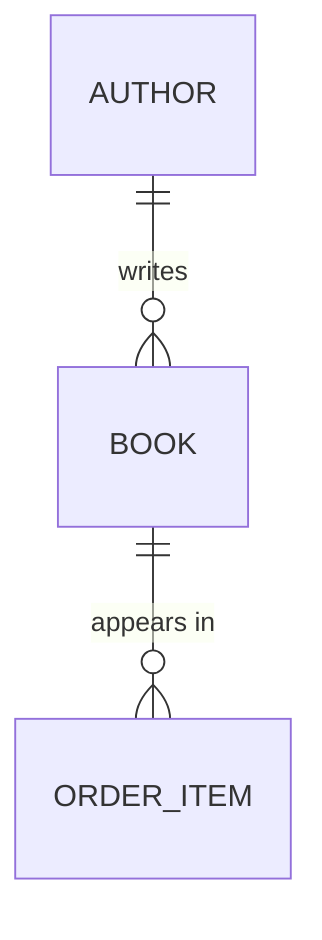

<!--
Copyright 2025-2026 Simon Martinelli and the AI Unified Process contributors.
Part of the AI Unified Process — https://unifiedprocess.ai
Licensed under the Apache License, Version 2.0. See LICENSE and NOTICE.
-->

# Entity model — format and mapping rules

Read this before writing the entity model of stage 7. The format contract of the skill's SKILL.md (rules 5–8) holds for every entity;
this page shows the document shape and how schema and ORM signals map onto it.

## Meaning

Structure comes from the schema, but meaning does not. A migration comment
records what the table was for on the day it was written, not every way the
code uses it now. Before writing an entity's description, read the project's
decision records and domain docs (ADRs found with the glob `docs/**/adr/`, which
matches `docs/adr/` as well as a subdirectory such as `docs/architecture/adr/`;
`CONTEXT.md`; a glossary) and the code that reads the table. If a row can play more than one role (for
example, a row that repeats a parent's default only to carry settings for
it), the description must say so.

## Document shape

For each entity, write:

- A `### ENTITY_NAME` heading (UPPER_SNAKE_CASE).
- A one-sentence description of what the entity represents (not what it
  contains — that's the table).
- An attribute table with exactly these 5 columns, in this order:
  `Attribute | Description | Data Type | Length/Precision | Validation Rules` (rule 6 of the format contract).

Match this exact shape — a Mermaid block with relationships only, followed by
one `###` section per entity with a filled 5-column table:

```markdown
# Entity Model

## Entity Relationship Diagram



### BOOK

A title available for sale in the catalog.

| Attribute | Description           | Data Type | Length/Precision | Validation Rules                  |
|-----------|-----------------------|-----------|------------------|-----------------------------------|
| id        | Unique identifier     | Long      | 19               | Primary Key, Sequence             |
| title     | Title of the book     | String    | 200              | Not Null                          |
| isbn      | ISBN-13 code          | String    | 13               | Not Null, Unique                  |
| price     | Sale price in CHF     | Decimal   | 10,2             | Not Null, Min: 0                  |
| author_id | Author of the book    | Long      | 19               | Not Null, Foreign Key (AUTHOR.id) |
```

## Types and validation

Map each type onto the seven types of rule 7 of the format contract — `Long`, `String`, `Integer`, `Decimal`,
`Boolean`, `Date`, `DateTime`, nothing else: semantics belong in the Description and
Validation Rules columns, not the Data Type column. Map validation to the AI
Unified Process vocabulary
(`Primary Key, Sequence`, `Primary Key`, `Primary Key, Foreign Key (TABLE.id)`,
`Not Null`, `Not Null, Unique`, `Not Null, Foreign Key (TABLE.id)`, `Optional`,
`Not Null, Min: X, Max: Y`, `Not Null, Values: A, B, C`, `Not Null, Format: Email`).
A key the database generates is `Primary Key, Sequence`. Use `Primary Key` for
a natural key and for each column of a composite key, and
`Primary Key, Foreign Key (TABLE.id)` for a composite key column that also
references another table. Don't fall back to `Not Null` for a key column; the
`#### Constraints` list below the table can then name the composite key.

Length/Precision comes from the **declared column type**, never from what
the column happens to hold. An unbounded text column (`TEXT`, `CLOB`,
`VARCHAR` without a length, Prisma `String` without `@db.VarChar(n)`) is `-`,
even when every value has a fixed length, such as a hex SHA-256. Put that
fixed length in the Description instead.

## Relationships

Derive the cardinality of each relationship line (the diagram holds relationships only, rule 5 of the format contract) from
foreign key constraints and ORM associations:

| ORM/SQL signal                                    | Mermaid relationship              |
|---------------------------------------------------|-----------------------------------|
| Foreign key `NOT NULL`, `@ManyToOne(optional=false)` | `A ||--o{ B`                   |
| Foreign key nullable, `@ManyToOne(optional=true)` | `A |o--o{ B`                      |
| Unique foreign key, `@OneToOne(optional=true)`    | `A ||--o| B`                      |
| `@OneToOne(optional=false)` on **both** sides     | `A ||--|| B`                      |
| `@ManyToMany` / join table                        | `A }o--o{ B` (via join entity)    |

A unique foreign key guarantees **at most one** B per A, not exactly one:
nothing forces the row to exist. Use `||--||` only when the schema makes the
row mandatory on both sides. Code that always creates the row, or a backfill
migration, doesn't count. A backfill actually shows that rows were once
missing.

Draw one relationship line for **every** foreign key column, not just the
structurally obvious parent. A table often carries a second foreign key,
such as a tenant or owner scope added later with `ALTER TABLE`. That column
gets its own line even when the entity already hangs off another parent.

If the document describes what a delete removes, trace `ON DELETE CASCADE`
(and ORM `cascade = REMOVE` / `orphanRemoval`) **transitively**. Deleting A
removes B, deleting B removes C, and C may belong to someone other than A's
owner, such as another tenant's rows that reference A's children. Say what
leaves the database and whose data it was, or leave delete behaviour out.
An incomplete cascade summary reads as complete and misleads more than no
summary.

## Tables to skip

Skip pure technical tables (Flyway's `flyway_schema_history`, Spring
session tables, audit/log tables that aren't part of the domain). If
unsure whether a table is domain-relevant, include it — it's easier for
the user to delete than to miss.

## Checks

Run these in stage 8, against the diagram of the module the entity belongs to when the project is split:

- Rules 5–8 of the format contract hold in every table and diagram; every Length/Precision matches the declared
  column (unbounded text is `-`); every key column says `Primary Key`.
- The mermaid diagram has a section for every entity it names, and every
  entity section appears in the diagram.
- Every `Foreign Key (TABLE.id)` in an attribute table has a relationship
  line between the two entities in the diagram, and every relationship line
  is backed by a foreign key or a join table.
- Every `||--||` in the diagram is backed by a schema that makes the row
  mandatory on both sides; otherwise it is `||--o|`.
