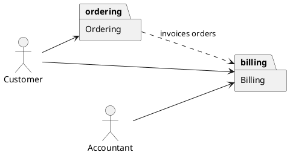
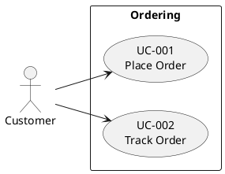
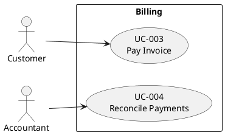
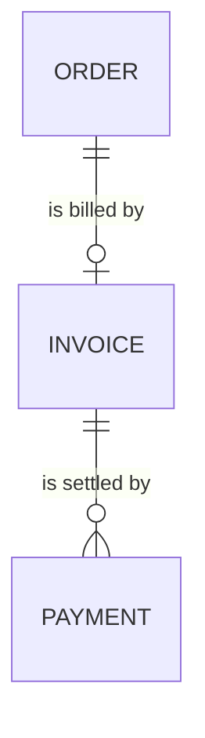

<!--
Copyright 2025-2026 Simon Martinelli and the AI Unified Process contributors.
Part of the AI Unified Process — https://unifiedprocess.ai
Licensed under the Apache License, Version 2.0. See LICENSE and NOTICE.
-->

# Modules — splitting the diagrams of a large project

Read this when stage 2 of the skill decides to split: the project has more than about 12 use cases or 15 entities and
the code shows at least two modules. Every rule of the skill's format contract holds in every module file.

## Finding the modules

Take the modules from the code, in this order of authority (the stack sections of `stack-signals.md` list the signals
per stack):

1. **Declared modules** — Maven or Gradle subprojects, Spring Modulith application modules, JPMS `module-info.java`,
   the projects of a `*.sln`, Nx or pnpm workspace packages, Django apps, Rails engines.
2. **Feature packages or directories** — `com.acme.booking`, `src/app/billing/`, a lazy-loaded route; route prefixes
   such as `/api/billing/**`.
3. **The database** — schemas, table name prefixes (`bil_invoice`).
4. **Clusters of the data** — when the code is cut by layer (`controller/`, `service/`, `repository/`) and nothing
   above applies, group the entities that the foreign keys hold tightly together, and cut where few foreign keys
   cross.

Then assign:

- **Every entity to exactly one module** — the module whose code writes it. An entity that several modules only read
  stays with its writer.
- **Every use case to exactly one module** — the module of its goal, usually the one that owns the entity the use
  case changes.
- **Name each module in business language** ("Billing", not `billing-core`), with one sentence on what it is
  responsible for.
- **Give each module a slug**: its name in lowercase kebab-case ("Billing" → `billing`, "Guest Management" →
  `guest-management`). The slug is the `package` alias in the overview, the folder `docs/use_cases/<slug>/`, and the
  file `docs/entity_model/<slug>.md`, so each name leads to the others.

Do not make a module of shared technical code (`common`, `util`, `security`, `config`): its tables and entry points
join the module they serve, and pure infrastructure is skipped as in stages 4 and 7. Aim for at most about 10 use
cases and 12 entities per module; a module far above that is split along its feature packages, two tiny modules that
share most of their foreign keys are merged. Note which signal the cut is based on; the summary names it.

Number the use cases module by module in the order of the overview, so each module holds one contiguous range.

## Use case diagrams (stage 5)

`docs/use_cases.puml` holds only the overview — the actors and one `package` per module, no use cases, so it stays
readable however large the system is. Each module gets its own diagram in `docs/use_cases/<slug>/use_cases.puml`,
with the template of stage 5 and the module name on the `rectangle`:







- The `@startuml` title of a module diagram is the module name; the overview's title is `Modules`.
  `/use-case-diagram` recognizes the split by it. Every `package` alias of the overview has its folder, and every
  folder its `package`.
- Every use case appears in exactly one module diagram. An actor appears in the overview and in every module diagram
  it has a use case in, with the same name and alias each time.
- An actor links to a module in the overview when it has a use case there.
- Draw a dependency `a ..> b : "<why>"` when a use case of module `a` uses data or a use case of module `b`; a foreign
  key from an entity of `a` to one of `b` is the usual evidence. `<<include>>` and `<<extend>>` stay inside one module
  diagram; across modules the dependency arrow says it.

## Specifications (stage 6)

Each specification goes into the folder of its module, next to the module's diagram
(`docs/use_cases/billing/UC-003-pay-invoice.md`). Its `**Requirements:**` link climbs one folder more:
`[FR-001](../../requirements.md)`.

## Entity model (stage 7)

`docs/entity_model.md` holds only the `## Modules` table, in the order of the diagram overview, with each module
linked to its file. Each module gets its own document `docs/entity_model/<slug>.md` in the format of stage 7 — title
with the module name, one sentence on the module, its own ER diagram, and the tables of the entities the module owns:

````markdown
<!-- docs/entity_model.md -->
# Entity Model

## Modules

| Module                                | Description                           | Entities             | Depends on |
|---------------------------------------|---------------------------------------|----------------------|------------|
| [Ordering](entity_model/ordering.md)  | Orders customers place and track      | CUSTOMER, ORDER, ... | -          |
| [Billing](entity_model/billing.md)    | Invoices for orders and their payment | INVOICE, PAYMENT     | Ordering   |
````

````markdown
<!-- docs/entity_model/billing.md -->
# Entity Model: Billing

Invoices for orders and their payment.

## Entity Relationship Diagram



From other modules: ORDER (Ordering).

### INVOICE

...
````

- Every entity has its `###` section exactly once, in the file of the module that owns it. Another module's diagram
  may name it in a relationship line, and the line `From other modules:` under that diagram lists it with its module.
- A module's diagram holds every relationship line of its own entities, including the ones to entities of other
  modules, so a foreign key that crosses modules appears in the diagram of the module whose table holds it.
- `Depends on` lists the modules whose entities this module's foreign keys point to, or `-`. Each module it lists has
  a `..>` arrow in the diagram overview.

## Module check (stage 8)

The overview's packages, the folders under `docs/use_cases/`, the rows of the `## Modules` table, and the files under
`docs/entity_model/` name the same modules (by slug) in the same order; every use case sits in exactly one module
diagram and its specification in the same module's folder; every entity section is in exactly one module file; a
module's diagram names only its own entities and those listed in its `From other modules:` line; every module in a
`Depends on` cell has a `..>` arrow in the overview. With modules, "the diagram" in the other checks of stage 8 means
the diagram of the module the use case or entity belongs to.

## Summary (stage 9)

List the modules with their use case and entity counts and name the signal the cut is based on — a module cut
recovered from foreign key clusters is a proposal, and the user may want it moved.
