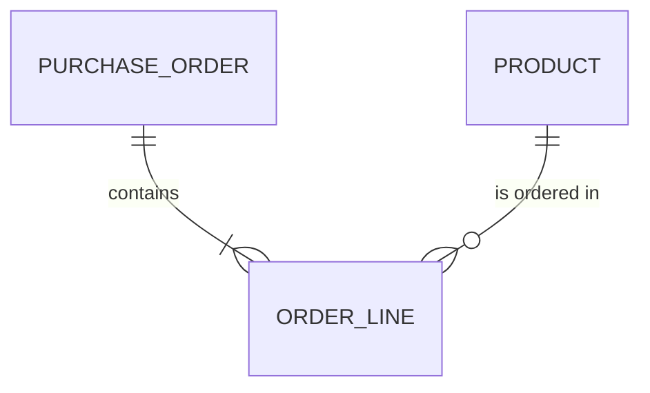

# Entity Model

## Entity Relationship Diagram

### PRODUCT

An article the shop sells.

| Attribute | Description        | Data Type | Length/Precision | Validation Rules       |
|-----------|--------------------|-----------|------------------|------------------------|
| id        | Unique identifier  | Integer   | 10               | Primary Key, Generated |
| name      | Product name       | String    | -                | Not Null               |
| price     | Price in CHF       | Decimal   | 10,2             | Not Null               |
| stock     | Units on hand      | Integer   | 10               | Not Null, Default 0    |

### PURCHASE_ORDER

An order a customer placed.

| Attribute     | Description              | Data Type | Length/Precision | Validation Rules       |
|---------------|--------------------------|-----------|------------------|------------------------|
| id            | Unique identifier        | Integer   | 10               | Primary Key, Generated |
| order_date    | Day the order was placed | Date      | -                | Not Null               |
| customer_name | Name of the customer     | String    | -                | Not Null               |

### ORDER_LINE

One product with its quantity and price within an order.

| Attribute  | Description                | Data Type | Length/Precision | Validation Rules             |
|------------|----------------------------|-----------|------------------|------------------------------|
| id         | Unique identifier          | Integer   | 10               | Primary Key, Generated       |
| order_id   | The order of this line     | Integer   | 10               | Not Null, Foreign Key        |
| product_id | The product of this line   | Integer   | 10               | Not Null, Foreign Key        |
| quantity   | Units ordered              | Integer   | 10               | Not Null                     |
| price      | Price per unit when ordered | Decimal  | 10,2             | Not Null                     |
