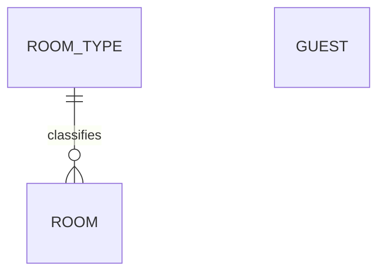

# Entity Model

## Entity Relationship Diagram

### ROOM_TYPE

A category of rooms with the same capacity.

| Attribute | Description              | Data Type | Length/Precision | Validation Rules      |
|-----------|--------------------------|-----------|------------------|-----------------------|
| id        | Unique identifier        | Long      | 19               | Primary Key, Sequence |
| name      | Name of the room type    | String    | 50               | Not Null, Unique      |
| capacity  | Maximum number of guests | Integer   | 10               | Not Null, Min: 1, Max: 10 |

### ROOM

A bookable room of the hotel.

| Attribute    | Description                 | Data Type | Length/Precision | Validation Rules                  |
|--------------|-----------------------------|-----------|------------------|-----------------------------------|
| id           | Unique identifier           | Long      | 19               | Primary Key, Sequence             |
| number       | Room number on the door     | String    | 10               | Not Null                          |
| room_type_id | Room type of the room       | Long      | 19               | Not Null, Foreign Key (ROOM_TYPE.id) |

### GUEST

A person who stays at the hotel.

| Attribute  | Description                          | Data Type | Length/Precision | Validation Rules      |
|------------|--------------------------------------|-----------|------------------|-----------------------|
| id         | Unique identifier                    | Long      | 19               | Primary Key, Sequence |
| first_name | First name of the guest              | String    | 100              | Not Null              |
| last_name  | Last name of the guest               | String    | 100              | Not Null              |
| email      | Email address of the guest           | String    | 255              | Not Null, Unique      |
| birth_date | Date of birth of the guest           | Date      | -                | Not Null              |
| version    | Version number for optimistic locking | Integer   | 10               | Not Null              |
