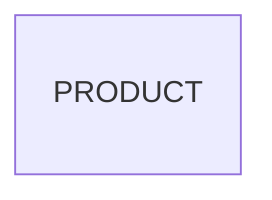

# Entity Model

## Entity Relationship Diagram

### PRODUCT

An article the shop sells.

| Attribute | Description                                         | Data Type | Length/Precision | Validation Rules          |
|-----------|-----------------------------------------------------|-----------|------------------|---------------------------|
| id        | Unique identifier                                   | Long      | 19               | Primary Key, Sequence     |
| name      | Product name                                        | String    | 100              | Not Null                  |
| category  | Category the product is in                          | String    | 50               | Not Null                  |
| price     | Price in CHF                                        | Decimal   | 10,2             | Not Null                  |
| in_stock  | Whether the product is in stock                     | Boolean   | 1                | Not Null                  |
| discount  | Discount in percent, 0 for a product without one    | Integer   | 10               | Not Null, Min: 0, Max: 50 |
