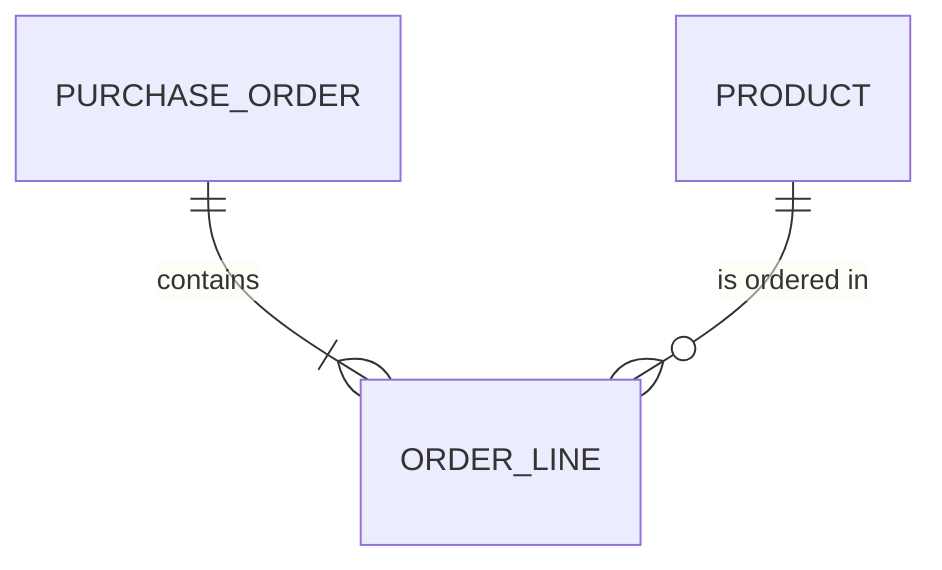

# Entity Model

## Entity Relationship Diagram

### PRODUCT

An article the shop sells.

| Attribute | Description                    | Data Type | Length/Precision | Validation Rules      |
|-----------|--------------------------------|-----------|------------------|-----------------------|
| id        | Unique identifier              | Long      | 19               | Primary Key, Sequence |
| name      | Product name                   | String    | 100              | Not Null              |
| category  | Category the product is in     | String    | 50               | Not Null              |
| price     | Price in CHF                   | Decimal   | 10,2             | Not Null              |
| in_stock  | Whether the product is in stock | Boolean   | 1                | Not Null              |

### PURCHASE_ORDER

An order a customer placed, confirmed by a sales clerk.

| Attribute  | Description                                 | Data Type | Length/Precision | Validation Rules          |
|------------|---------------------------------------------|-----------|------------------|---------------------------|
| id         | Unique identifier                           | Long      | 19               | Primary Key, Sequence     |
| order_date | Day the order was placed                    | Date      | -                | Not Null                  |
| status     | Processing state of the order               | String    | 20               | Not Null, Values: OPEN, CONFIRMED |
| version    | Version for optimistic locking              | Integer   | 10               | Not Null                  |

### ORDER_LINE

One product with its quantity and price within an order.

| Attribute         | Description                  | Data Type | Length/Precision | Validation Rules                           |
|-------------------|------------------------------|-----------|------------------|--------------------------------------------|
| id                | Unique identifier            | Long      | 19               | Primary Key, Sequence                      |
| purchase_order_id | Order the line belongs to    | Long      | 19               | Not Null, Foreign Key (PURCHASE_ORDER.id)  |
| product_id        | Product ordered              | Long      | 19               | Not Null, Foreign Key (PRODUCT.id)         |
| quantity          | Number of items ordered      | Integer   | 10               | Not Null, Min: 1, Max: 9999                |
| price             | Price per item in CHF        | Decimal   | 10,2             | Not Null                                   |
