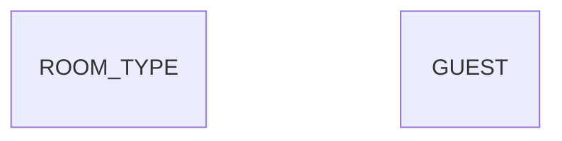

# Entity Model

## Entity Relationship Diagram

### ROOM_TYPE

A category of rooms with shared capacity and price.

| Attribute   | Description           | Data Type | Length/Precision | Validation Rules          |
|-------------|-----------------------|-----------|------------------|---------------------------|
| id          | Primary key           | Long      | 19               | Primary Key, Sequence     |
| name        | Room type name        | String    | 50               | Not Null, Unique          |
| description | Room type description | String    | 500              | Optional                  |
| capacity    | Guest capacity        | Integer   | 10               | Not Null, Min: 1, Max: 10 |
| price       | Nightly price in CHF  | Decimal   | 10,2             | Not Null                  |

### GUEST

A person who stays at the hotel.

| Attribute | Description        | Data Type | Length/Precision | Validation Rules      |
|-----------|--------------------|-----------|------------------|-----------------------|
| id        | Primary key        | Long      | 19               | Primary Key, Sequence |
| firstName | Guest's first name | String    | 100              | Not Null              |
| lastName  | Guest's last name  | String    | 100              | Not Null              |
| email     | Contact email      | String    | 150              | Not Null, Unique      |
