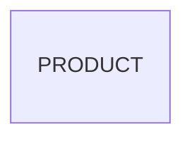

# Entity Model

## Entity Relationship Diagram

### PRODUCT

A product of the shop.

| Attribute | Description       | Data Type | Length/Precision | Validation Rules      |
|-----------|-------------------|-----------|------------------|-----------------------|
| id        | Unique identifier | Long      | 19               | Primary Key, Identity |
| name      | Name              | String    | 100              | Not Null              |
| category  | Category          | String    | 100              | Not Null              |
| price     | Price             | Decimal   | -                | Not Null              |
| in_stock  | Can be bought     | Boolean   | -                | Not Null              |
