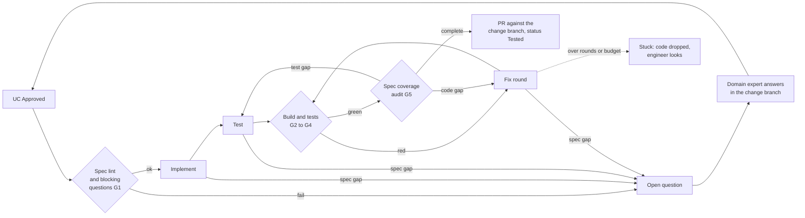

<!--
Copyright 2025-2026 Simon Martinelli and the AI Unified Process contributors.
Part of the AI Unified Process — https://unifiedprocess.ai
Licensed under the Apache License, Version 2.0. See LICENSE and NOTICE.
-->

# AI Unified Process Software Werkstatt: Architecture

> **Status: released** behind `v1`; the AI Unified Process Studio starts it (Studio UC-061). This page is the concept: roles, stations, gates, branch
> model, metrics and rollout. How to run it: [werkstatt.md](werkstatt.md). Why it works this way:
> [design/werkstatt.md](design/werkstatt.md).

## Purpose and scope

The Werkstatt turns the approved use cases of a change into a tested pull request without a human writing code. The
use case (UC) is the work order. There is no task layer in between.

**In scope**

- Picking up the use cases with status *Approved* in a change branch
- Implementing and testing them across the layers in `docs/architecture/stack.md`
- Checking the result against gates, including the spec coverage audit
- Stopping and asking when the specification has a gap
- Returning the result as one pull request against the change branch

**Out of scope**

- Writing or approving specifications. Domain experts own the *What*.
- Designing the harness. The software engineer owns architecture and rules.
- Deploying to production. The Werkstatt ends at a pull request; acceptance follows with `/acceptance-protocol`.

The Werkstatt reuses the existing AI Unified Process skills (`/use-case-implement`, `/use-case-test`, the coverage
agents, `spec_lint.py` of `/spec-review`, `/open-questions`). It adds only the orchestration around them.

## Roles

People decide what and how; agents do the work in between. Agents work autonomously and are not steered step by step.

| Role | Owns | Touches the Werkstatt at |
| --- | --- | --- |
| Domain expert | Requirements, use cases, glossary, answers to open questions | Sets a UC to *Approved*; answers open questions; signs off acceptance |
| Software engineer | Architecture, ADRs, stack file, harness rules, CI | Reviews and merges the Werkstatt pull request; tunes the harness when the first-pass rate drops |
| Orchestrator | Selection, order, gates, retries, budgets | The reusable workflow `aiup-werkstatt.yml` and the scripts in `pipelines/werkstatt/` |
| Agents | Code and tests for one UC | One headless Claude Code session per station |

The name comes from this picture: the orchestrator is Santa, the agents are the elves, and the specification is the
wish list. It is a workshop, not a factory: the domain expert and the software engineer stay in it.

## Pipeline overview

A use case moves through the stations from left to right. Only two loops go back: a failed gate goes to a fix
round, and a gap in the specification goes to a person.

Everything from *UC Approved* to the pull request is automatic. People act at the edges: the domain expert answers
open questions, the software engineer reviews the pull request and looks at a stuck use case.

## Stations in detail

Each station has one clear output. A station never fixes the work of another station.

| # | Station | Input | Output | Tool |
| --- | --- | --- | --- | --- |
| 1 | Select | The change branch | The UCs whose specification changed against the default branch and that are *Approved*, in id order | `select-ucs.sh` |
| 2 | G1 spec lint | One UC | Pass, or blocked with the findings | `spec_lint.py --only UC-XXX` (no LLM) and the blocking open questions |
| 3 | Implement | The UC, its diff against the default branch | Code with `UC-XXX BR-YYY` markers, or a new blocking open question | `/aiup-core:use-case-implement` or `/<plugin>:implement` |
| 4 | Test | The same UC, fresh session | Tests per layer; a test that disagrees with the code stays red | `/aiup-core:use-case-test` or the plugin's test skills |
| 5 | G2 to G4 build | The branch | Green or red, with the log | The Build, Unit tests and Integration tests commands of the stack file |
| 6 | G5 audit | UC, code, tests | Coverage matrix, gaps in code and in tests | `uc-coverage-layered` or the plugin's `uc-coverage` agent, read-only |
| 7 | Fix round | Build log or code gaps | New commit; at most `max_rounds` rounds | The implement command with the findings |
| 8 | Test round | Test gaps | The missing tests | The test command with the gaps |
| 9 | Pull request | The commits of every UC that passed | One pull request against the change branch, status *Tested* | `peter-evans/create-pull-request` |
| 10 | Review | The pull request | Merge into the change branch, or change request | Software engineer |
| 11 | Change pull request | The change branch | Specification, code and tests reach the default branch together | Software engineer |
| 12 | Acceptance | The merged UCs | Acceptance protocol, UC to *Done* | `/acceptance-protocol` |

**Why separate sessions for implement, test and audit.** The tester and the auditor read the specification, not the
implementer's reasoning. So the specification stays the oracle, and no agent grades its own work. A test that
disagrees with the code stays red and goes into the fix round.

**Lanes.** The implementer may not change tests, and the tester may only change tests, the open questions and
build files (`pom.xml`, `package.json`, a test runner's configuration), because a test may need a dependency. What
crosses the lane is reverted and listed in the pull request, so a drifting skill shows up in review; the tester's
build file changes are kept and listed.

## Quality gates and the andon cord

A UC carries code into the pull request only when every gate is green. A failed gate sends it back to a fix round,
never forward.

| Gate | Checks | On failure |
| --- | --- | --- |
| G1 Spec lint | `spec_lint.py` for the UC: ids, links, format, weak words; and no blocking open question on the UC | Blocked: only the findings, no code |
| G2 Build | Compiles, migrations run, code generation works | Fix round |
| G3 Tests | All tests the stack file's commands run are green | Fix round |
| G4 Harness | What the build enforces (for example ArchUnit rules), plus the lane guard | Fix round; lane crossings are reverted |
| G5 Spec coverage | Every main success scenario step, alternative flow and business rule has code and a test | Code gap: fix round; test gap: test round |
| G6 Budget | At most `max_rounds` fix rounds and `max_cost_usd` per UC | Stuck: code dropped, kept as a diff in the run records |

**The andon cord.** When a station finds a gap in the specification, it does not guess. It records a question with
`/open-questions` in `docs/open_questions.md`, marked `**Blocking:** Yes`. The Werkstatt reads that file after every
station; it does not ask the agent. A blocking question that names the UC stops it, and only the question goes into
the pull request. The domain expert answers it in the change branch and updates the UC; the next run builds the UC
again.

This is the main difference from code-first agent pipelines: a gap becomes a question for a person, not a hidden
assumption in the code.

**Outcomes.** `ready` (all gates green), `blocked` (G1 or a blocking question), `stuck` (G6), `pending` (not built
because an earlier UC of the run stopped). The run stops at the first UC that is not `ready`, because later UCs of
the same change may build on it.

## Spec checks

`/spec-review` should run at three points, so the domain expert sees problems before the agents build, not after.
Only the third is part of the Werkstatt today.

| When | What | Effect | State |
| --- | --- | --- | --- |
| Every push to a change branch that touches `docs/`, also before *Approved* | Lint of the whole specification (`spec_lint.py`) | Status check and pull request comment; make it required for the default branch | Planned |
| A UC is *Approved* and changed in the push | Semantic review of that UC (part B of `/spec-review`) | Pull request comment with findings and "Ready for Approved"; advisory, never blocks | Planned |
| Before each UC build in the Werkstatt | Lint of that UC, gate G1 | Hard gate: the UC ends blocked | Done |

## Runtime

Version 1 runs fully on GitHub Actions with headless Claude Code. No extra server is needed.

- **Shared implementation.** The reusable workflow `.github/workflows/aiup-werkstatt.yml` of this marketplace,
  next to `aiup-generate.yml`. A thin stub in the project repository calls it. The stations live in
  `pipelines/werkstatt/` and are checked out at `engine_ref`, the same tag or branch as the stub's `uses:` line.
- **Start.** From the AI Unified Process Studio, like a generate run (Studio UC-061), or by hand with
  `workflow_dispatch` on a change branch, with or without UC ids.
- **Selection.** Without UC ids, every UC whose specification differs from the merge base with the default branch
  and whose status is *Approved*.
- **The status is the memory.** A finished UC moves to *Tested* in the pull request (*Implemented* when the stack
  has no coverage audit). After the merge it is no longer selected; a blocked, stuck or pending UC stays *Approved*
  and is selected again. The Werkstatt keeps no state of its own.
- **Agent runtime.** Claude Code CLI in print mode (`claude -p`), with aiup-core and the layer plugins whose skills
  the stack file names (read from the Plugins table of the layer catalog), or one combined stack plugin. Each station
  is its own call, so sessions do not share context.
- **Permissions.** `--permission-mode bypassPermissions` with `Bash(git:*)` denied, as in `aiup-generate`. Agents
  never commit; the scripts commit after each station.
- **Secrets.** `ANTHROPIC_API_KEY` or `CLAUDE_CODE_OAUTH_TOKEN`, passed explicitly by the stub.
- **Budget.** `max_turns` per station; the `total_cost_usd` of every session is summed per UC against `max_cost_usd`.
- **Result.** One pull request against the change branch, never a commit on it. The run records (summary per UC,
  metrics, build logs, lint output, coverage matrix, dropped diffs) are a build artifact.

## Branch model

Specification, code and tests of one change live in one branch and reach the default branch in one pull request. So
the default branch never holds a specification without its code, and the two never drift apart.

1. The domain expert opens a branch `change/<name>` from the default branch and edits requirements, glossary and use
   cases there.
2. The domain expert sets the affected UCs to *Approved*. This is the spec gate.
3. The Werkstatt runs on this branch. It opens one pull request against the change branch with the code, the tests
   and the new status of every UC that passed all gates.
4. On a gap in the specification, the domain expert answers the open question in the change branch. The next run
   builds the UC again.
5. The software engineer merges the Werkstatt pull request into the change branch. The change branch's own pull
   request brings specification, code and tests to the default branch together.

- **The unit is the change, not the UC.** One change often touches several UCs and requirements. This matches the
  feature, change and bug flows of the AI Unified Process.
- **Serial inside a branch.** The UCs of one change run in one job, in id order. Give a UC that others include or
  extend the lower id.
- **Parallel across branches.** Several change branches can run at the same time. Conflicts in `requirements.md` or
  in migrations are solved at merge time, like any Git conflict.
- **Keep changes small.** A long-lived branch drifts away from the default branch. Rebase often, and merge one change
  before the next one touches the same area.
- **The default branch is protected.** Only merged pull requests reach it.

## Metrics and control room

The first-pass rate is the key number: it shows whether a problem sits in the specification or in the harness.

| Metric | Definition | Points to |
| --- | --- | --- |
| First-pass rate | Share of UCs `ready` with zero fix rounds | Low: harness or stack skills need work |
| Blocked rate | Share of UCs that pulled the andon cord | High: specifications are not ready at *Approved* |
| Fix rounds per UC | Average rounds in the fix loop | Rising: unclear rules or flaky tests |
| Lead time | *Approved* to merged change pull request | Waiting time on review or answers |
| Cost per UC | Sum of `total_cost_usd` over all stations | Budget and pricing for clients |
| Review changes | Commits by the engineer after a Werkstatt pull request | Gaps the gates do not catch yet |

Every station writes one line to `metrics.jsonl` (UC, station, round, exit code, cost, seconds) in the run records.
The AI Unified Process Studio can show them in its run overview; `/next` already gives the status counts per UC.

## Rollout plan and risks

Start with one UC on a test project and grow only when the numbers are stable.

1. **Marketplace branch.** The reusable workflow and the stations, incubated on `change/werkstatt` and merged into
   `main`, tested in CI with a fake `claude` (`pipelines/werkstatt/self-test.sh`). Done.
2. **Test project.** A Vaadin/jOOQ room booking project with two UCs (`simasch/werkstatt-demo`): ready, blocked on
   a specification gap, answered, and ready again, with the project's CI on every pull request. Opus 5.5 built both
   UCs with no fix round for about 3 USD each; Sonnet 5 needed three rounds for one and decided a gap silently. Done.
3. **AI Unified Process Studio.** Specification first (Studio UC-061, and UC-042, UC-052, UC-004 extended), then the
   code: starting a run on the branch the user works on, the outcome per UC after the run, and the change branch's
   own pull request. Done.
4. **Release.** Merged into `main`, `v1` moved, and the Studio offers the Werkstatt. Done. Bitbucket follows.
5. **Client project.** A brownfield project, with the Werkstatt as an opt-in per module.

| Risk | Mitigation |
| --- | --- |
| Specification passes the lint but is still ambiguous | Andon cord; the planned semantic review; review changes as feedback into the `/spec-review` rules |
| Non-deterministic results between runs | Strong gates; spec coverage instead of trusting the output |
| Cost per UC grows | Turn and cost budget; measure before scaling |
| Merge conflicts in shared layers | Small change branches; serial inside a branch; rebase often |
| Agent changes tests to make them pass | Test station in a separate session; the lane guard reverts test changes by the implementer |
| Engineer becomes a review bottleneck | Only green UCs carry code; coverage matrix in the pull request body |
