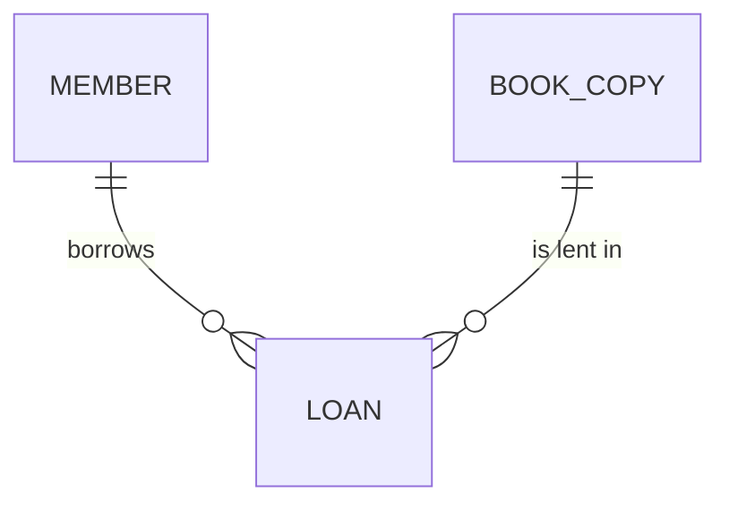

# Entity Model

## LOAN

| Attribute   | Description                                 | Data Type | Length/Precision | Validation Rules        |
|-------------|---------------------------------------------|-----------|------------------|-------------------------|
| id          | Unique identifier                           | Long      | 19               | Primary Key, Sequence   |
| memberId    | The member who borrowed the copy            | Long      | 19               | Not Null, Foreign Key   |
| bookCopyId  | The copy lent                               | Long      | 19               | Not Null, Foreign Key   |
| lentAt      | When the copy was lent                      | DateTime  | -                | Not Null                |
| returnedAt  | When the copy was returned; empty while open | DateTime | -                | Optional, after lentAt  |
